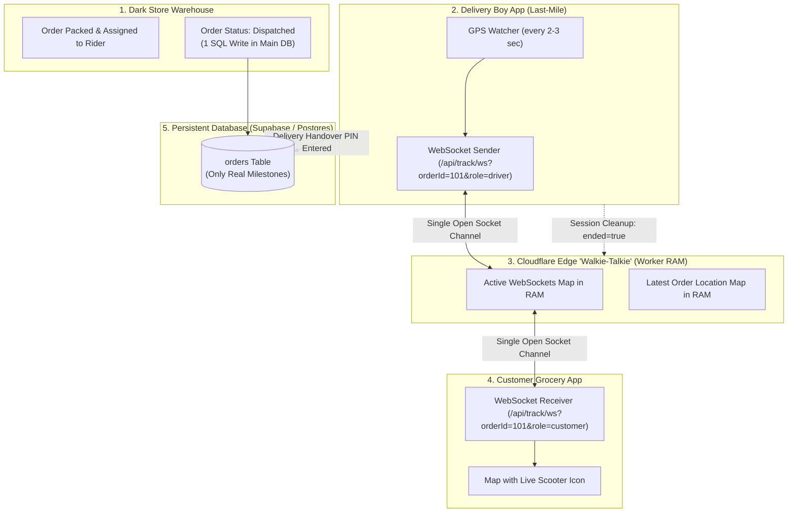

# Quick Commerce "Walkie-Talkie" (In-Memory Realtime GPS) Architecture Blueprint
### Zepto / Blinkit / Swiggy Instamart-Style 10-Minute Last-Mile Tracking on Cloudflare Edge

---

## 1. Executive Summary

When building a **Quick Commerce (10-minute grocery delivery)** app:
* **The Catalog, Inventory & Payment** live in a persistent database (PostgreSQL / Supabase / MySQL).
* **The 10-Minute Delivery Rider's live GPS** must **NEVER** write to your persistent SQL database every 2 seconds. If 100 delivery riders send GPS every 2 seconds over 10-minute deliveries, your database will process over **1,800,000 writes/day**, triggering heavy cloud bills or crashing free tiers.
* **The Walkie-Talkie Architecture** routes the delivery boy's live GPS coordinates strictly through **Cloudflare Worker RAM & WebSockets**. It beams the live scooter position directly onto the customer's phone map with **0 database disk writes** and **₹0 extra server cost**.

---

## 2. High-Level Flow Diagram



---

## 3. Production Cloudflare Worker Code (`worker.js`)

Save this file as `worker.js` in your new Quick Commerce Cloudflare project:

```javascript
// ============================================================================
// QUICK COMMERCE REALTIME GPS STREAMING WORKER (WALKIE-TALKIE)
// Zero disk writes • 100% In-Memory RAM • Native WebSockets
// ============================================================================

const liveLocations = new Map(); // orderId -> { orderId, riderId, lat, lng, heading, speed, timestamp }
const activeSockets = new Map(); // orderId -> Set of WebSockets

export default {
  async fetch(request, env) {
    const url = new URL(request.url);
    const path = url.pathname;
    const method = request.method;

    // Standard CORS headers for your mobile app and web clients
    const corsHeaders = {
      'Access-Control-Allow-Origin': '*',
      'Access-Control-Allow-Methods': 'GET, POST, OPTIONS',
      'Access-Control-Allow-Headers': 'Content-Type, Authorization'
    };

    if (method === 'OPTIONS') {
      return new Response(null, { headers: corsHeaders });
    }

    // 1. WEBSOCKET GATEWAY (Primary Walkie-Talkie)
    if (path === '/api/track/ws') {
      return handleWebSocket(request, url, corsHeaders);
    }

    // 2. HTTP FALLBACK (For older devices or background network pings)
    if (path === '/api/track/update' && method === 'POST') {
      return await handleHttpUpdate(request, corsHeaders);
    }

    // 3. LATEST SNAPSHOT (When customer opens screen for the first time)
    if (path === '/api/track/latest' && method === 'GET') {
      return handleHttpLatest(url, corsHeaders);
    }

    return new Response(JSON.stringify({ status: 'Quick Commerce GPS Worker Active' }), {
      headers: { 'Content-Type': 'application/json', ...corsHeaders }
    });
  }
};

// ----------------------------------------------------------------------------
// WEBSOCKET HANDLER
// ----------------------------------------------------------------------------
function handleWebSocket(request, url, corsHeaders) {
  const upgradeHeader = request.headers.get('Upgrade');
  if (!upgradeHeader || upgradeHeader.toLowerCase() !== 'websocket') {
    return new Response('Expected Upgrade: websocket', { status: 426, headers: corsHeaders });
  }

  const orderId = url.searchParams.get('orderId');
  if (!orderId) {
    return new Response('Missing orderId query parameter', { status: 400, headers: corsHeaders });
  }

  const pair = new WebSocketPair();
  const [client, server] = Object.values(pair);
  server.accept();

  const key = String(orderId);
  if (!activeSockets.has(key)) {
    activeSockets.set(key, new Set());
  }
  activeSockets.get(key).add(server);

  // Send the most recent known position immediately on connect
  const latest = liveLocations.get(key);
  if (latest) {
    server.send(JSON.stringify({ type: 'location', data: latest }));
  }

  server.addEventListener('message', event => {
    try {
      const msg = JSON.parse(event.data);

      if (msg.type === 'location' && msg.data) {
        const payload = {
          orderId: key,
          riderId: msg.data.riderId || null,
          lat: Number(msg.data.lat),
          lng: Number(msg.data.lng),
          heading: Number(msg.data.heading || 0),
          speed: Number(msg.data.speed || 0),
          timestamp: Date.now()
        };

        // Save in RAM
        liveLocations.set(key, payload);

        // Broadcast to all listening customer sockets for this order
        const sockets = activeSockets.get(key);
        if (sockets) {
          const out = JSON.stringify({ type: 'location', data: payload });
          for (const ws of sockets) {
            if (ws !== server) {
              try { ws.send(out); } catch(e) { sockets.delete(ws); }
            }
          }
        }
      } else if (msg.type === 'ping') {
        server.send(JSON.stringify({ type: 'pong', timestamp: Date.now() }));
      }
    } catch(err) {}
  });

  server.addEventListener('close', () => {
    const s = activeSockets.get(key);
    if (s) {
      s.delete(server);
      if (s.size === 0) activeSockets.delete(key);
    }
  });

  return new Response(null, { status: 101, webSocket: client, headers: corsHeaders });
}

// ----------------------------------------------------------------------------
// HTTP LOCATION UPDATE (Fallback)
// ----------------------------------------------------------------------------
async function handleHttpUpdate(request, corsHeaders) {
  let body;
  try { body = await request.json(); } catch(e) {
    return new Response(JSON.stringify({ error: 'Invalid JSON' }), { status: 400, headers: corsHeaders });
  }

  const key = String(body.orderId);

  // If order is completed or cancelled, immediately purge from RAM and close sockets
  if (body.ended || body.status === 'delivered' || body.status === 'cancelled') {
    liveLocations.delete(key);
    const sockets = activeSockets.get(key);
    if (sockets) {
      const out = JSON.stringify({ type: 'ended', orderId: key });
      for (const ws of sockets) {
        try { ws.send(out); ws.close(1000, 'Order ended'); } catch(e){}
      }
      activeSockets.delete(key);
    }
    return new Response(JSON.stringify({ ok: true, ended: true }), {
      headers: { 'Content-Type': 'application/json', ...corsHeaders }
    });
  }

  const payload = {
    orderId: key,
    riderId: body.riderId || null,
    lat: Number(body.lat),
    lng: Number(body.lng),
    heading: Number(body.heading || 0),
    speed: Number(body.speed || 0),
    timestamp: Date.now()
  };

  liveLocations.set(key, payload);

  // Broadcast to open WebSockets
  const sockets = activeSockets.get(key);
  if (sockets && sockets.size > 0) {
    const out = JSON.stringify({ type: 'location', data: payload });
    for (const ws of sockets) {
      try { ws.send(out); } catch(e) { sockets.delete(ws); }
    }
  }

  return new Response(JSON.stringify({ ok: true, timestamp: payload.timestamp }), {
    headers: { 'Content-Type': 'application/json', ...corsHeaders }
  });
}

// ----------------------------------------------------------------------------
// HTTP SNAPSHOT (For initial screen load)
// ----------------------------------------------------------------------------
function handleHttpLatest(url, corsHeaders) {
  const orderId = url.searchParams.get('orderId');
  if (!orderId) {
    return new Response(JSON.stringify({ error: 'orderId parameter required' }), { status: 400, headers: corsHeaders });
  }

  const loc = liveLocations.get(String(orderId));
  if (!loc) {
    return new Response(JSON.stringify({ found: false }), {
      headers: { 'Content-Type': 'application/json', ...corsHeaders }
    });
  }

  return new Response(JSON.stringify({ found: true, data: loc }), {
    headers: { 'Content-Type': 'application/json', ...corsHeaders }
  });
}
```

---

## 4. `wrangler.toml` Deployment File

Create `wrangler.toml` in the same directory:

```toml
name = "quick-commerce-gps-hub"
main = "worker.js"
compatibility_date = "2024-01-01"

# Run in terminal to deploy:
# npx wrangler login
# npx wrangler deploy
```

---

## 5. Client Code: Delivery Rider App (Sender)

In your delivery boy app (JavaScript / React Native / Flutter):

```javascript
// Connect to the Cloudflare Walkie-Talkie
let trackingSocket = null;

function startRiderLiveStream(orderId, riderId) {
  const wsUrl = `wss://your-worker-subdomain.workers.dev/api/track/ws?orderId=${orderId}`;
  trackingSocket = new WebSocket(wsUrl);

  trackingSocket.onopen = () => {
    console.log('✅ Walkie-Talkie connected to Cloudflare Edge RAM');
  };

  // Watch device GPS
  navigator.geolocation.watchPosition((pos) => {
    const { latitude, longitude, heading, speed } = pos.coords;

    const payload = {
      type: 'location',
      data: {
        riderId: riderId,
        lat: latitude,
        lng: longitude,
        heading: heading || 0,
        speed: speed || 0
      }
    };

    // Send through open WebSocket (0 HTTP requests, 0 DB writes!)
    if (trackingSocket && trackingSocket.readyState === WebSocket.OPEN) {
      trackingSocket.send(JSON.stringify(payload));
    }
  }, (err) => console.error(err), {
    enableHighAccuracy: true,
    maximumAge: 2000,
    timeout: 5000
  });
}

// When delivery is handed over to customer (Order Delivered)
function stopRiderLiveStream(orderId) {
  if (trackingSocket) {
    trackingSocket.close();
    trackingSocket = null;
  }
  // Tell Worker RAM to purge order
  fetch(`https://your-worker-subdomain.workers.dev/api/track/update`, {
    method: 'POST',
    headers: { 'Content-Type': 'application/json' },
    body: JSON.stringify({ orderId: String(orderId), ended: true, status: 'delivered' })
  }).catch(() => {});
}
```

---

## 6. Client Code: Customer Grocery App (Receiver)

In the customer’s tracking screen:

```javascript
let customerSocket = null;

function startCustomerLiveTracking(orderId, scooterMapMarker) {
  // 1. Fetch initial position immediately via HTTP
  fetch(`https://your-worker-subdomain.workers.dev/api/track/latest?orderId=${orderId}`)
    .then(r => r.json())
    .then(res => {
      if (res.found && res.data) {
        scooterMapMarker.setLatLng([res.data.lat, res.data.lng]);
      }
    });

  // 2. Open Walkie-Talkie WebSocket for smooth realtime movement
  const wsUrl = `wss://your-worker-subdomain.workers.dev/api/track/ws?orderId=${orderId}`;
  customerSocket = new WebSocket(wsUrl);

  customerSocket.onmessage = (event) => {
    const msg = JSON.parse(event.data);

    if (msg.type === 'location' && msg.data) {
      const { lat, lng, heading } = msg.data;
      // Animate scooter icon smoothly on map
      scooterMapMarker.setLatLng([lat, lng]);
      if (heading) scooterMapMarker.setRotationAngle(heading);
    } else if (msg.type === 'ended') {
      console.log('🎉 Delivery rider has arrived at your door!');
      customerSocket.close();
    }
  };
}
```

---

## 7. The Golden Rules of Quick Commerce Database Hygiene

| Event | Where It Goes | Type |
| :--- | :--- | :--- |
| **Catalog & Inventory (Milk, Bread, Veggies)** | Persistent SQL Database | Standard SQL |
| **Cart & Razorpay Checkout** | Persistent SQL Database | Standard SQL |
| **Dark Store Packing & Dispatch** | Persistent SQL Database | 1 Status Update |
| **10-Minute Moving Scooter GPS** | **Cloudflare Edge RAM (Walkie-Talkie)** | **0 Database Writes** |
| **Customer Doorstep Handover (OTP / PIN)** | Persistent SQL Database | 1 Status Update |

By following this exact separation, your Quick Commerce app will handle **thousands of deliveries a day** without ever burning through database write quotas or receiving unexpected cloud bills.
